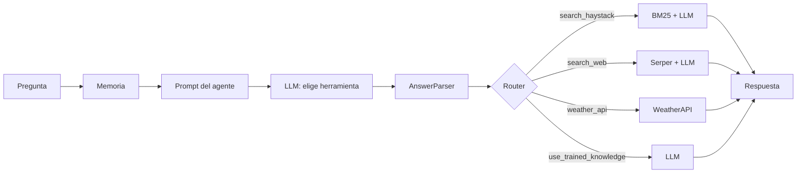

# Asistente Virtual Agrícola

Asistente conversacional en español que responde preguntas sobre agricultura digital. Un agente decide si la pregunta se resuelve con una base de datos de empresas Agrotech, una búsqueda web, el clima de una ciudad o el conocimiento del propio modelo.

> **Demo:** _captura pendiente_ (añadir `docs/demo.gif`).

## ¿Qué hace?

- Interpreta la pregunta y elige la herramienta más adecuada.
- **Base de empresas Agrotech (RAG):** busca en un TXT de empresas españolas con BM25 y responde con los fragmentos encontrados.
- **Búsqueda web:** consulta Google (vía Serper) para temas de actualidad y cita que la respuesta viene de la web.
- **Clima:** devuelve el tiempo actual y las alertas meteorológicas de una ciudad (WeatherAPI).
- **Conocimiento del modelo:** responde preguntas técnicas o conceptuales, por ejemplo cómo diseñar un sistema de riego inteligente.
- **Memoria:** guarda cada mensaje en Supabase para mantener el contexto de la conversación.

## Arquitectura



El LLM del agente devuelve un JSON con `tool_name` y `query`. El router envía la consulta a la rama correspondiente, y cada rama produce la respuesta final.

## Tecnologías

- [Haystack 2](https://haystack.deepset.ai/) para los pipelines y componentes
- OpenAI `gpt-4o-mini` como modelo de lenguaje
- BM25 en memoria para la recuperación de documentos
- Serper.dev (búsqueda en Google) y WeatherAPI.com
- Supabase para el historial de conversaciones
- Gradio para la interfaz de chat

## Estructura del proyecto

```
.
├── main.py           # Punto de entrada
├── app.py            # Interfaz Gradio
├── pipeline.py       # Construcción del agente y respuesta a cada pregunta
├── router.py         # Parseo de la decisión del LLM y rutas del router
├── memory.py         # Historial de conversación y persistencia en Supabase
├── weather.py        # Componente de clima y alertas
├── prompts.py        # Plantillas de prompt
├── config.py         # Variables de entorno y constantes
├── requirements.txt
└── .env.example
```

## Instalación

Requiere Python 3.10 o superior.

```bash
git clone <url-del-repo>
cd rag
python -m venv .venv
source .venv/bin/activate
pip install -r requirements.txt
```

## Configuración

1. Copia la plantilla de variables y rellénala:

   ```bash
   cp .env.example .env
   ```

2. Define las variables en `.env`:

| Variable | Obligatoria | Descripción |
|---|---|---|
| `OPENAI_API_KEY` | Sí | Clave de OpenAI |
| `SERPERDEV_API_KEY` | Sí | Clave de [Serper.dev](https://serper.dev) |
| `WEATHER_API` | Sí | Clave de [WeatherAPI.com](https://www.weatherapi.com) |
| `SUPABASE_URL` | Sí | URL de tu proyecto en Supabase |
| `SUPABASE_KEY` | Sí | Clave de Supabase |
| `AGROTECH_DATA_PATH` | No | Ruta al TXT de empresas (por defecto `data/empresas_agrotech.txt`) |

3. Crea la tabla `conversaciones` en Supabase con las columnas `session_id`, `role`, `content` y `timestamp`.

4. Coloca el TXT de empresas en `data/empresas_agrotech.txt` o indica su ruta en `AGROTECH_DATA_PATH`. Cada línea no vacía se indexa como un documento. El repositorio no incluye esa base de datos.

## Uso

```bash
python main.py
```

Abre la URL que muestra la terminal (por defecto `http://127.0.0.1:7860`).

## Ejemplos de preguntas

- ¿Qué empresas ofrecen maquinaria agrícola en Cataluña?
- ¿Qué servicios ofrece Digitanimal para mi finca de olivos?
- ¿Cuál es el clima en Córdoba?
- ¿Por qué subió recientemente el precio del aceite de oliva? _(usa búsqueda web)_
- Crea un manejo integrado de plagas para Antracnosis en olivo _(usa el conocimiento del modelo)_

## Limitaciones

- La recuperación BM25 trata cada línea del TXT como un documento. No hay búsqueda semántica, así que las consultas deben compartir palabras con los datos.
- El historial se comparte entre todos los usuarios de una misma ejecución.
- La elección de herramienta depende de que el LLM devuelva un JSON válido. Si no lo hace, el chat responde con un aviso.
- Todas las fuentes externas (OpenAI, Serper, WeatherAPI, Supabase) son servicios de pago o con límites de uso.
- El proyecto todavía no tiene tests automatizados.

## Próximos pasos

- Añadir tests con `pytest` para el parser, el router y el componente de clima.
- Búsqueda semántica con embeddings en lugar de solo BM25.
- Historial separado por usuario o sesión de navegador.
- Migrar a `OpenAIChatGenerator`, que es el componente recomendado en Haystack 2.

## Licencia

MIT. Consulta el archivo [LICENSE](LICENSE).

## Autoría 
Desarrollador – Alejandro Iasir Moraga Moya